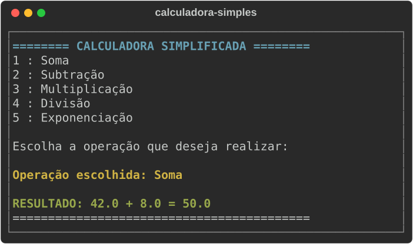

# 🧮 Calculadora Simples em Python | Exercício de Lógica e Dicionários


[](https://github.com/ryanvmorais/python-calculadora-simples/actions/workflows/ci.yml)


Este repositório contém uma **Calculadora Simples em Python**, criada como material de estudo para quem está iniciando na programação. O foco principal é demonstrar como organizar **menus interativos** e **realizar operações matemáticas básicas** de forma limpa.

### 🎯 Objetivo do Projeto:

Praticar o uso de **Dicionários**, **Loops de repetição** e **Tratamento de Erros**. É o projeto ideal para entender como o Python processa entradas do usuário e entrega resultados matemáticos em tempo real.

---

### 📚 O que você vai aprender com este projeto?

Este exercício foi estruturado para consolidar conceitos essenciais de algoritmos:

- **Dicionários (Mapping):** como mapear símbolos matemáticos (`+`, `-`, `*`, `/`) para nomes legíveis.
- **Tratamento de Erros (Try/Except):** como evitar que o programa feche ao tentar dividir por zero ou digitar letras.
- **Manipulação de Listas:** transformar chaves de dicionários em listas para acessar opções por números (índices).
- **UX no Terminal:** uso do módulo `os` para limpar a tela e criar uma interface dinâmica.

---

### 🧠 Guia de Implementação (A Lógica por trás do Código):

Para quem está começando, o maior desafio não é a sintaxe, mas a **montagem do raciocínio**. Confira o passo a passo da construção desta calculadora:

1. **Dicionário de Operações:** em vez de usar vários `if`, guardamos as operações em um dicionário (`dict`). Isso permite que o programa "saiba" o nome de cada símbolo automaticamente.
2. **Menu Dinâmico:** o código percorre o dicionário e cria um menu numerado. Se você adicionar uma operação no futuro, o menu se atualiza sozinho.
3. **Captura Segura:** usamos `int(input()) - 1` para converter a escolha do usuário no índice correto do Python, que sempre começa em 0.
4. **Blindagem (Try/Except):** se o usuário digitar algo errado, o programa avisa o erro educadamente em vez de travar.

---

### 🛠️ Tecnologias e Ferramentas:

Para garantir a melhor experiência de aprendizado, o projeto utiliza as seguintes tecnologias:

| Ferramenta | Descrição |
| :--- | :--- |
| **Python 3.12+** | Linguagem principal do projeto. O programa usa só a biblioteca padrão, sem dependências externas. |
| **uv** | Gerenciador de dependências e ambientes virtuais: cria o ambiente e roda o projeto com um único comando. |
| **Terminal** | Interface onde o programa roda e recebe as entradas do usuário (CMD, PowerShell ou o terminal do VS Code/PyCharm). |

As ferramentas de qualidade (Ruff, Black, Mypy e Pytest) estão em [Qualidade e testes](#qualidade-e-testes). Para o porquê de cada escolha, veja [docs/stack.md](docs/stack.md).

---

### ⚙️ Como rodar o projeto localmente:

**Pré-requisitos:** [Python 3.12+](https://www.python.org/downloads/) e [uv](https://docs.astral.sh/uv/getting-started/installation/). Para conferir, rode `python --version` e `uv --version`.

1.  **Clone o repositório:**
    ```bash
    git clone https://github.com/ryanvmorais/python-calculadora-simples.git
    cd python-calculadora-simples
    ```
2.  **Execute o programa:** no terminal (CMD, PowerShell ou o do VS Code/PyCharm), dentro da pasta do projeto. O `uv` cria o ambiente virtual sozinho na primeira execução.
    ```bash
    uv run main.py
    ```
3.  **Prefere dois cliques? Use o atalho:** no Windows, abra o `iniciar_calculadora.bat`; no Linux/macOS, execute o `iniciar_calculadora.sh` no terminal. Os scripts conferem se o `uv` está instalado antes de iniciar.

> ⚠️ **Nota:** o programa detecta se você está no Windows, Linux ou macOS para limpar a tela do jeito certo.

---

### Qualidade e testes

O projeto tem uma suíte de testes automatizados (`pytest`) e um portão de qualidade que roda no CI a cada push e a cada PR:

```bash
uv sync                 # instala as dependências de desenvolvimento
uv run ruff check .     # lint + ordem de imports
uv run black --check .  # formatação
uv run mypy             # checagem de tipos
uv run pytest           # testes
```

Para o mapa de cada tecnologia da stack (o que é, por que foi escolhida, o que estudar), veja [docs/stack.md](docs/stack.md). Para o comportamento esperado do programa e o histórico de decisões, veja [specs/](specs/). Para o detalhamento de arquitetura e convenções, veja [CLAUDE.md](CLAUDE.md).

---

### 📋 Atividades para praticar (Desafios de Evolução):

Para exercitar o que aprendeu, tente modificar o código e implementar estas novas funcionalidades:

1. **🏆 Histórico de Operações:** crie uma lista (ex.: `historico_calculos`) que guarde cada resultado e uma nova opção no menu para exibi-la, sem que os dados sumam a cada limpeza de tela.
   - **O Aprendizado:** diferenciar variáveis de valor único de estruturas que acumulam dados, e manter informação em memória durante a sessão.
2. **📊 Novas Funções Matemáticas:** expanda o dicionário de operações para incluir o **Resto da Divisão (%)** e a **Raiz Quadrada (√)**, tratando o caso em que o segundo valor não é necessário.
   - **O Aprendizado:** ver o dicionário de operações crescer sem novos `if`, e lidar com operações que pedem um número diferente de entradas.
3. **🎨 Feedback Visual:** use a biblioteca `colorama` para exibir os resultados em **verde** e as mensagens de erro (como divisão por zero) em **vermelho**.
   - **O Aprendizado:** instalar uma dependência externa com `uv add` e usá-la sem quebrar o resto do programa.

---

### 🧭 Continue praticando:

Este projeto faz parte de uma trilha de exercícios de lógica de programação em Python. Depois deste, experimente:

- **[Pedra, Papel e Tesoura em Python](https://github.com/ryanvmorais/python-pedra-papel-tesoura):** dicionários e Programação Orientada a Objetos.
- **[Jogo da Velha em Python](https://github.com/ryanvmorais/python-jogo-da-velha):** matrizes e Programação Orientada a Objetos.

Veja todos os projetos e vídeos do canal em [aprenda-com-ryan-morais](https://github.com/ryanvmorais/aprenda-com-ryan-morais).

---

### 💡 Ficou com alguma dúvida ou tem sugestões?

Aprender algo novo tem seus desafios, mas estou aqui para caminharmos juntos! Se você encontrou algum erro, teve dificuldade em rodar o projeto ou pensou numa melhoria que tornaria este material ainda mais didático:

- **Abra uma [Issue](https://github.com/ryanvmorais/python-calculadora-simples/issues):** descreva sua dúvida ou sugestão. É a melhor forma de trocarmos conhecimento e ajudarmos outras pessoas que tenham a mesma dúvida.
- **Contribua com código:** quer propor uma melhoria? Veja o passo a passo no [CONTRIBUTING.md](CONTRIBUTING.md).
- **Me mande um e-mail:** se preferir algo mais privado, escreva para [**contato@ryanmorais.com.br**](mailto:contato@ryanmorais.com.br).

Ficarei muito feliz em ver seu progresso e receber seu feedback para melhorar cada vez mais nossos materiais de estudo! 🤝

---

### ⚖️ Licença

Este projeto está sob a **Licença MIT**. Isso significa que você pode usar, copiar e modificar o código à vontade, inclusive nos seus projetos. Para mais detalhes, consulte o arquivo [LICENSE](LICENSE).
